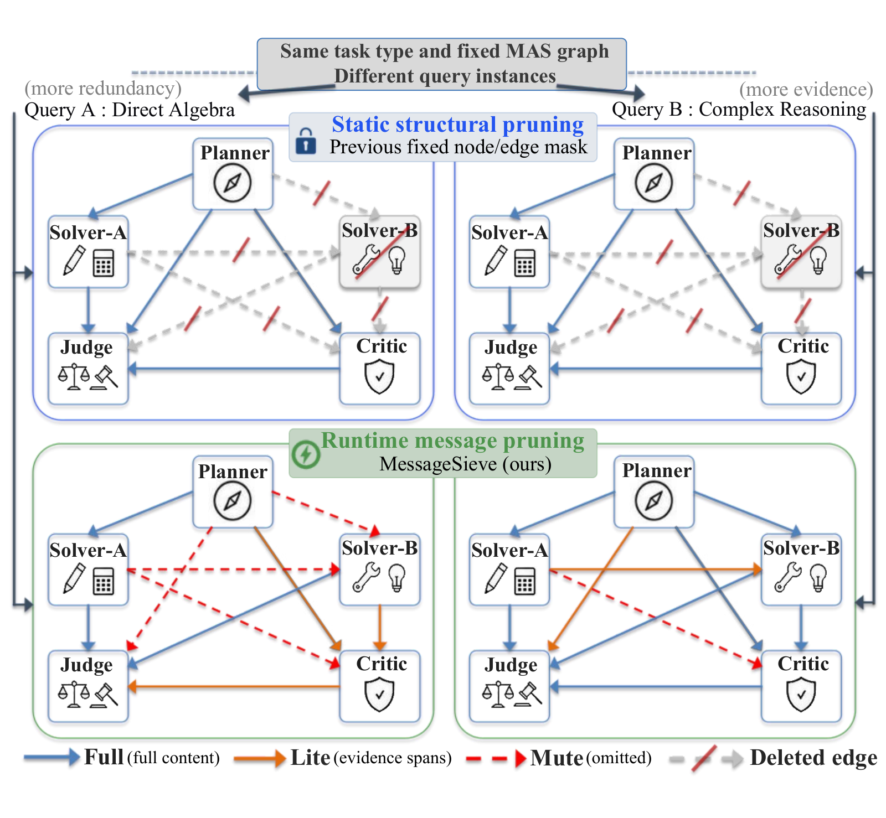
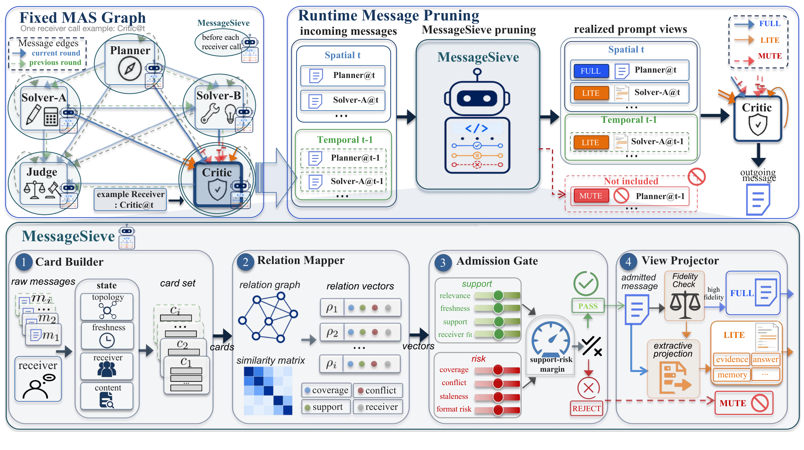

# 🧩 [EMNLP'26] MessageSieve

[Paper](https://aclanthology.org/2026.emnlp-main.2179/) · [PDF](https://aclanthology.org/2026.emnlp-main.2179.pdf)

Code for **[MessageSieve: Runtime Message Pruning for Accurate and Efficient LLM-Based Multi-Agent Communication](https://aclanthology.org/2026.emnlp-main.2179/)** (EMNLP 2026 Main Conference).

<p align="center">
  
</p>

## 📣 News

- **[2026-11]** Code released, including MessageSieve, task prompts, and evaluation scripts.
- **[2026-10]** Paper published in the [EMNLP 2026 proceedings](https://aclanthology.org/2026.emnlp-main.2179/).
- **[2026-08]** MessageSieve accepted to EMNLP 2026 Main Conference.

## 🔎 Method Overview

<p align="center">
  
</p>

Multi-agent systems often exchange repeated reasoning and messages that add little for the receiving agent. MessageSieve keeps the candidate graph unchanged and prunes messages before each receiver call. Its four stages—Card Builder, Relation Mapper, Admission Gate, and View Projector—choose **FULL** original text, **LITE** extractive evidence, or **MUTE**, without training or additional LLM calls.

The algorithm is in [masbench/methods](masbench/methods); role prompts and task workflows are in [masbench/presets/catalog.py](masbench/presets/catalog.py) and [masbench/tasks](masbench/tasks).

## 🚀 Quick Start

### 📦 Installation

Use Python 3.10+:

```bash
python -m venv .venv
source .venv/bin/activate
python -m pip install -r requirements.txt
```

### 🔌 Model Connection

Use an existing Qwen3-8B vLLM server with an OpenAI-compatible endpoint. Edit [configs/qwen3_8b.yaml](configs/qwen3_8b.yaml) to match its address and served model name:

```yaml
model:
  model: Qwen/Qwen3-8B
  base_url: http://127.0.0.1:8000/v1
```

This file also contains the shared generation parameters. If your server requires authentication, set `OPENAI_API_KEY`.

### 🗂️ Data Preparation

Download the upstream benchmark files, then convert the tasks you want to run:

- [GPQA-Diamond](https://huggingface.co/datasets/Idavidrein/gpqa)
- [AQuA-RAT](https://huggingface.co/datasets/deepmind/aqua_rat)
- [MATH500](https://huggingface.co/datasets/HuggingFaceH4/MATH-500)
- [LiveCodeBench](https://huggingface.co/datasets/livecodebench/code_generation_lite)
- [MBPP+](https://huggingface.co/datasets/evalplus/mbppplus)

```bash
python experiments/prepare_data.py --dataset gpqa_diamond --source /path/to/gpqa_diamond.csv
python experiments/prepare_data.py --dataset aqua_rat --source /path/to/AQuA/test.json
python experiments/prepare_data.py --dataset math500 --source /path/to/MATH-500/test.parquet
python experiments/prepare_data.py --dataset livecodebench --source /path/to/test6.jsonl
python experiments/prepare_data.py --dataset mbppplus --source /path/to/mbppplus-test.parquet
```

The converter keeps your selected records in input order.

### ▶️ Run

Choose MessageSieve, Full-MAS (all messages), or Single (one agent):

```bash
python experiments/run.py --config configs/runs/gpqa_diamond/messagesieve.yaml
python experiments/run.py --config configs/runs/gpqa_diamond/full_mas.yaml
python experiments/run.py --config configs/runs/gpqa_diamond/single.yaml
```

Replace `gpqa_diamond` with `aqua_rat`, `math500`, `livecodebench`, or `mbppplus`. Each run generates answers, scores them automatically, and saves predictions, communication traces, and metrics under `outputs/`.

<details>
<summary>Running code tasks (LiveCodeBench / MBPP+)</summary>

The code judge uses system Python on Linux and requires root access with chroot and network namespace support. On Ubuntu/Debian:

```bash
sudo apt-get update
sudo apt-get install -y python3 python3-numpy libc-bin util-linux
sudo --preserve-env=OPENAI_API_KEY .venv/bin/python experiments/run.py \
  --config configs/runs/mbppplus/messagesieve.yaml
```

</details>

## 📖 Citation

```bibtex
@inproceedings{you-etal-2026-messagesieve,
  title = {{M}essage{S}ieve: Runtime Message Pruning for Accurate and Efficient {LLM}-Based Multi-Agent Communication},
  author = {You, Nianhao and Dong, Yubo and Wang, Jun and Fan, Hehe and Yang, Yi},
  editor = {Lee, Hung-Yi and Dev, Sunipa and Li, Jessy and Elliott, Desmond},
  booktitle = {Proceedings of the 2026 Conference on Empirical Methods in Natural Language Processing},
  month = oct,
  year = {2026},
  address = {Budapest, Hungary},
  publisher = {Association for Computational Linguistics},
  url = {https://aclanthology.org/2026.emnlp-main.2179/},
  pages = {49544--49566}
}
```

## 📄 License

Released under the [MIT License](LICENSE).
